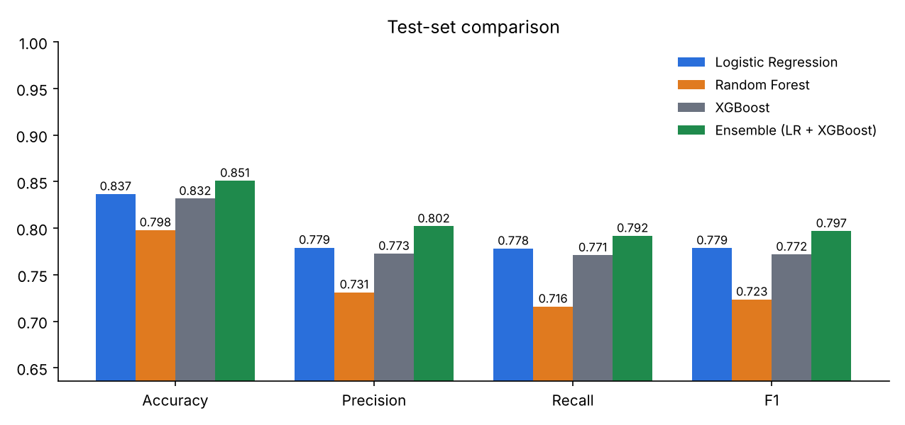
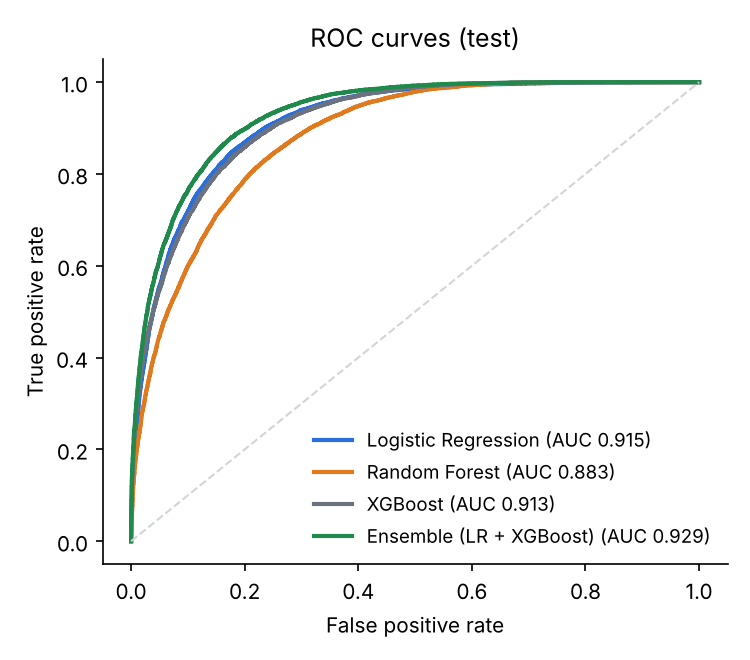
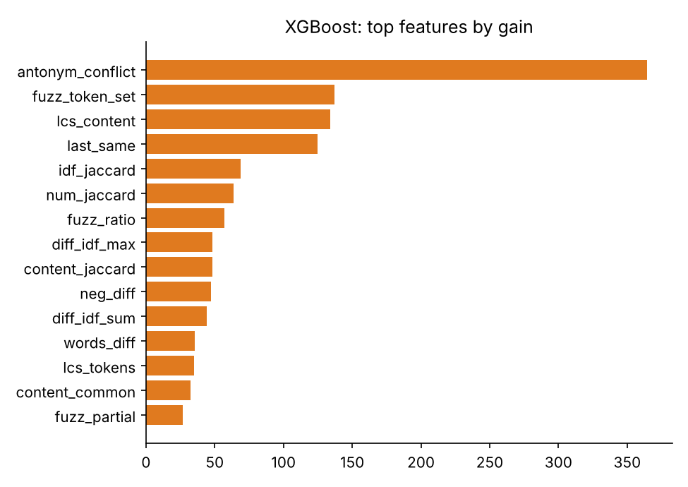
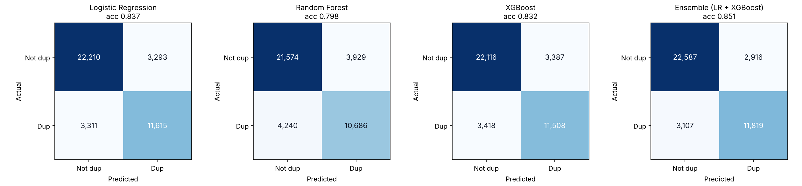
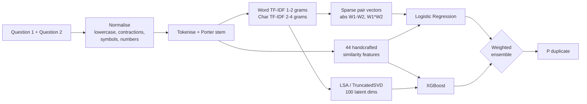

<div align="center">

# QueryTwin

**Duplicate question detection with NLP and machine learning**

Given two questions, QueryTwin predicts whether they ask the same thing. Given a new question, it searches a question bank for existing duplicates.

[](https://querytwin.onrender.com)


**85.10% test accuracy · 0.797 F1 · 0.929 ROC-AUC** on 40,429 held-out Quora question pairs

</div>

---

## Why this matters

Q&A sites, support desks and forums accumulate the same question in many phrasings. Detecting duplicates lets a platform merge threads, point users to an existing answer before they post, and keep a knowledge base clean. Quora released its **Question Pairs** dataset for this task: 404,290 human-labelled pairs, 36.9% duplicates.

## Results

All models were trained on the same 80% training split (plus contrastive augmentation, see below), tuned on a 10% validation split, and evaluated **once** on a 10% held-out test split.

| Model | Accuracy | Precision | Recall | F1 | ROC-AUC |
|---|---|---|---|---|---|
| Logistic Regression | 83.67% | 0.779 | 0.778 | 0.779 | 0.915 |
| Random Forest | 79.79% | 0.731 | 0.716 | 0.723 | 0.883 |
| XGBoost | 83.17% | 0.773 | 0.771 | 0.772 | 0.913 |
| **Ensemble (LR + XGBoost)** | **85.10%** | 0.802 | 0.792 | **0.797** | 0.929 |

The deployed model is the **LR + XGBoost ensemble**, selected on validation F1. It blends Logistic Regression over sparse TF-IDF pair vectors with XGBoost over dense similarity and LSA features (0.55 / 0.45 weights, tuned on validation log-loss). The two models make partly different errors, so the blend beats either one alone.

<p align="center">
  
</p>

<p align="center">
  
  
</p>

<sub>Reading the feature chart: `antonym_conflict` ranks first by gain partly because the 10k augmented training negatives are separated almost entirely by it. On raw Quora pairs, fuzzy token-set matching, content-word LCS and IDF-weighted overlap carry most of the signal.</sub>

<p align="center">
  
</p>

## How it works



**1. Text normalisation.** HTML unescaping, URL removal, lower-casing, contraction expansion (`what's → what is`, `can't → can not`), currency and symbol words (`$ → dollar`, `₹ → rupee`), and number magnitudes (`50k → 50000`). Stop-word removal keeps negations (`not`, `never`, `without`), because they flip meaning.

**2. Features (245 dense + 40,000 sparse).**

| Group | Examples | What it captures |
|---|---|---|
| Length | char/word lengths, differences, ratios | size mismatch |
| Token overlap | common words, Jaccard, overlap ratios | surface similarity |
| IDF-weighted overlap | shared-word IDF mass, IDF of mismatched words | *rare* shared words matter more than "what/is/the" |
| Fuzzy matching | ratio, partial, token-sort, token-set, WRatio (RapidFuzz) | paraphrase and re-ordering |
| Vector similarity | word and char TF-IDF cosine, LSA cosine, LSA abs-diff and product | topic-level semantics |
| Structure | same first/last word, same question word, numbers match, capitalised-entity overlap | intent and entity agreement |
| Robustness | antonym conflict, LCS token order, negation counts, exact match | known bag-of-words blind spots (below) |
| Sparse pair vectors | abs(W1 − W2) and W1 ⊙ W2 over 20k word n-grams | which words differ and which are shared (for LR) |

**3. Models.** Logistic Regression (C tuned on validation), Random Forest, and XGBoost with early stopping on validation. Every vectoriser and the LSA projection are fitted on the training split only.

**4. Serving.** A FastAPI service loads the model bundle once. Pair scoring takes milliseconds. Duplicate search is two-stage: TF-IDF cosine retrieves the top 100 candidates from the question bank, then the classifier re-scores each `(query, candidate)` pair.

## Fixing bag-of-words blind spots

Testing the first trained model on hand-written cases exposed three failure modes typical of TF-IDF systems. Each one got a targeted fix:

| Case | Before | After | Fix |
|---|---|---|---|
| "How can I **lose** weight quickly?" vs "How could I **gain** weight quickly?" | 0.89 duplicate ❌ | 0.09 not duplicate ✅ | antonym-conflict feature + **contrastive augmentation** |
| "What are the **best** movies of 2015?" vs "…**worst** movies…" | – | 0.00 not duplicate ✅ | same |
| "become a data scientist after engineering" vs "become an engineer after data science" | 0.61 duplicate ❌ | 0.57 duplicate ⚠️ | LCS token-order features help only slightly: **still an open limitation** (see below) |
| Identical question, different casing/punctuation | 0.82 | 1.00 | normalised exact-match rule |
| "How do I lose weight fast?" vs "What is the quickest way to lose weight?" | – | 0.94 duplicate ✅ | (true paraphrase still detected) |

**Contrastive augmentation.** Only about 0.3% of Quora pairs contain an opposite-meaning word swap, too few for the model to learn from. During training, QueryTwin takes real training questions, swaps one word for its opposite (`best ↔ worst`, `buy ↔ sell`, `android ↔ iphone`…), and adds 10,000 of these as labelled non-duplicates. This happens **only on the training split**, so validation and test metrics still measure performance on untouched Quora data.

## Quick start

```bash
git clone https://github.com/bhaskardwivedii/querytwin.git
cd querytwin
pip install -r requirements.txt

# Use the included trained model
uvicorn qqp.api:app --port 8000          # open http://localhost:8000

# Or retrain from scratch (downloads the dataset automatically, ~30 min on 2 CPU cores)
python -m qqp.train
python -m qqp.evaluate                   # error analysis -> outputs/error_analysis.md
pytest -q                                # 19 tests
```

Command-line prediction:

```bash
python -m qqp.predict --q1 "How do I learn Python?" --q2 "What is the best way to learn Python?"
python -m qqp.predict --interactive
```

## API

| Method | Endpoint | Body | Returns |
|---|---|---|---|
| `GET` | `/` | | web demo |
| `GET` | `/health` | | model name, test metrics, index size |
| `POST` | `/predict` | `{"question1": "...", "question2": "..."}` | `{"duplicate": true, "probability": 0.93}` |
| `POST` | `/predict/batch` | `{"pairs": [["q1", "q2"], ...]}` (≤1000) | one result per pair |
| `POST` | `/search` | `{"question": "...", "top_k": 5}` | most likely duplicates from the question bank |

Interactive docs are served at `/docs` (Swagger UI).

```bash
curl -X POST https://querytwin.onrender.com/predict \
  -H "Content-Type: application/json" \
  -d '{"question1": "How can I improve my English?", "question2": "What should I do to speak English fluently?"}'
```

## Deploy on Render

The repo includes a [`render.yaml`](render.yaml) blueprint. In the Render dashboard choose **New + → Blueprint**, pick this repository, and click **Apply**. It installs only the runtime dependencies (`requirements-deploy.txt`, using CPU-only XGBoost) and serves a 30k-question search bank from `data/question_bank.txt`, which fits the free plan's 512 MB of RAM. On the free plan the service sleeps after 15 minutes idle, so the first request after that takes about 30–50 seconds.

A [`Dockerfile`](Dockerfile) is also included for any container host.

## Project structure

```
qqp/
  data.py        dataset download (checksum-verified), loading, contrastive augmentation
  preprocess.py  normalisation, tokenisation, stemming
  features.py    TF-IDF, LSA and 44 handcrafted pair features
  pipeline.py    per-model input matrices
  train.py       train, tune and benchmark LR / RF / XGBoost / ensemble; write reports
  evaluate.py    error analysis on the held-out test split
  predict.py     DuplicateDetector: pair scoring and two-stage duplicate search
  api.py         FastAPI service
  static/        web demo
outputs/         metrics.json, results.md, figures, model.joblib
tests/           pytest suite
```

## Evaluation notes and limitations

- **No leakage from preprocessing.** Vectorisers, IDF weights, LSA and scaling are fitted on training data only. Model and threshold choices use validation only, and the test split is scored once.
- **No "magic" features.** Kaggle leaderboard solutions reached higher scores with question-frequency and graph features (how often a question appears across pairs). Those exploit how the dataset was sampled and don't transfer to new questions, so they are deliberately excluded.
- **Question overlap.** As in most QQP work, the split is random over pairs, so a question can appear in both training and test pairs. Scores on completely unseen questions would be somewhat lower.
- **Label noise.** Quora's labels are human judgements and are not guaranteed to be correct. `outputs/error_analysis.md` lists the model's most confident "mistakes", and several are arguably mislabelled.
- **Symbols are dropped in preprocessing**, so "C++" and "C#" both become "c" and those pairs get over-matched. Mapping technical tokens (`c++ → cplusplus`, `c# → csharp`, `.net → dotnet`) before cleaning is a planned fix.
- **Lexical, not deep semantic.** This is a classical NLP system. Paraphrases that share almost no words remain hard, and so do pairs that use the *same* words with roles swapped ("data scientist after engineering" vs "engineer after data science"), because most features are order-insensitive. Fine-tuning a sentence transformer (e.g. a cross-encoder) is the natural next step and typically reaches around 90% on this dataset.

## Dataset

[Quora Question Pairs](https://quoradata.quora.com/First-Quora-Dataset-Release-Question-Pairs) (Quora, 2017): 404,290 pairs. It is downloaded automatically on first training run and verified by SHA-256 checksum. It is not redistributed in this repo, except for a 30k-question sample used as the demo's search bank.
